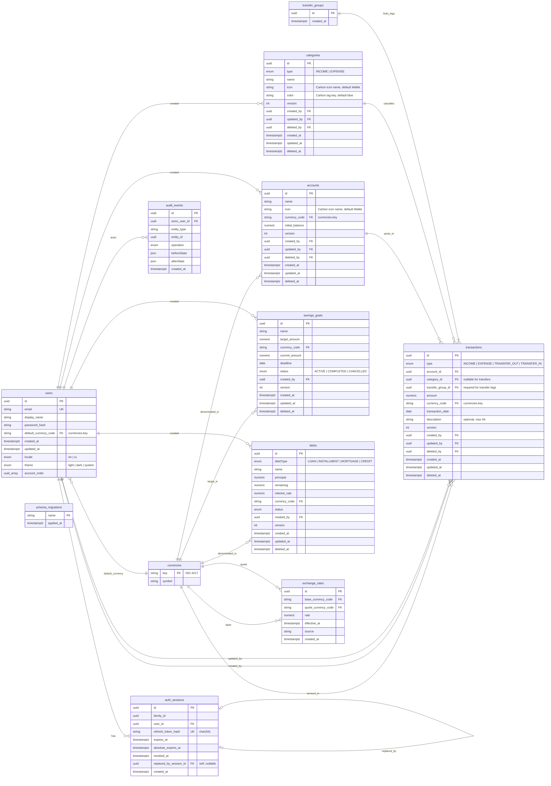

# Balance — диаграмма сущностей и связей

Модель данных выведена из [требований](./README.md). Правила для агента: [`AGENTS.md`](../../AGENTS.md).

**Контекст:** одно финансовое пространство (сущностей `Space` / tenant нет); счета пользователям **не принадлежат**; атрибуция живёт на операциях (`created_by`).

---

## 1. Схема



### Модель перевода

Перевод — это **две связанные строки** в `transactions` с общим `transfer_group_id`:

```text
Account A (USD)  --TRANSFER_OUT-->  transferGroupId = X
Account B (USD)  --TRANSFER_IN-->   transferGroupId = X
```

Создание перевода выполняется в **одной транзакции PostgreSQL** ([`idempotency-concurrency.md`](./idempotency-concurrency.md)): обе ноги атомарны.

У ног перевода `category_id` равен `NULL`. Суммы всегда положительные; направление закодировано в `type`.

---

## 2. Мощность связей и ограничения

| Связь                                                   | Мощность связи | Примечание                                                                                                 |
| ------------------------------------------------------- | -------------- | ---------------------------------------------------------------------------------------------------------- |
| users → auth_sessions                                   | 1:N            | `auth_sessions.user_id`; удаление пользователя удаляет его сессии                                          |
| auth_sessions → auth_sessions                           | 0..1           | `replaced_by_session_id`, смена refresh-токена внутри `family_id`                                          |
| schema_migrations                                       | —              | Журнал миграций, без связей с доменными таблицами                                                          |
| users → transactions                                    | 1:N            | `created_by` — атрибуция, а не владение счётом                                                             |
| accounts → transactions                                 | 1:N            | Баланс выводится из операций по счёту                                                                      |
| categories → transactions                               | 1:N            | Только INCOME/EXPENSE; у transfer `category_id = NULL`                                                     |
| transfer_groups → transactions                          | 1:2            | Ровно две ноги на перевод                                                                                  |
| currencies → accounts / transactions / users            | 1:N            | FK на `currencies.key` (ISO 4217). Колонки справочника: `key`, `symbol`. Названия и точности в таблице нет |
| users → savings_goals / debts                           | 1:N            | `created_by`                                                                |
| currencies → savings_goals / debts / exchange_rates     | 1:N            | Суммы целей и долгов и курсы ссылаются на `currencies.key`                 |
| users → audit_events                                    | 1:N            | `actor_user_id`                                                             |

---

## 3. Рекомендуемые индексы

```text
transactions: account_id, category_id, created_by, transaction_date, deleted_at
accounts:     deleted_at, currency_code
categories:   type, deleted_at
auth_sessions: user_id, family_id, refresh_token_hash (активные, revoked_at IS NULL)
```

---

## 4. Намеренно исключено

| Сущность                       | Причина                                                                                     |
| ------------------------------ | ------------------------------------------------------------------------------------------- |
| Budget / лимиты расходов       | Вне scope ([`scope.md`](./scope.md))                                                        |
| Space / Tenant / AccountMember | Решение не принято ([`multi-user.md`](./multi-user.md))                                    |
| Event Sourcing                 | Не нужен; предпочтительны состояние и журнал изменений ([`principles.md`](./principles.md)) |
