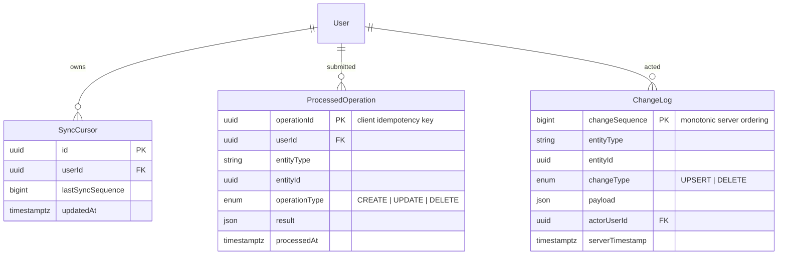

# Parked data model (pull-sync / local queue)

Not part of the live [`ERD.md`](../../ERD.md). Do not add these tables.

| Entity | Storage | Purpose |
| --- | --- | --- |
| `SyncCursor` | PostgreSQL (+ client cache) | Pull: all changes after sequence N |
| `ProcessedOperation` | PostgreSQL | Duplicate `operationId` is not applied twice (may later fold into the live API idempotency store) |
| `ChangeLog` | PostgreSQL | Change feed for pull |
| `PendingMutation` | IndexedDB only (not PG) | Client mutation queue |

Extra fields on shared entities if this phase is built: `clientTimestamp`, `serverTimestamp`. The live schema already has `version`, `deletedAt`, `createdAt`, `updatedAt`.
